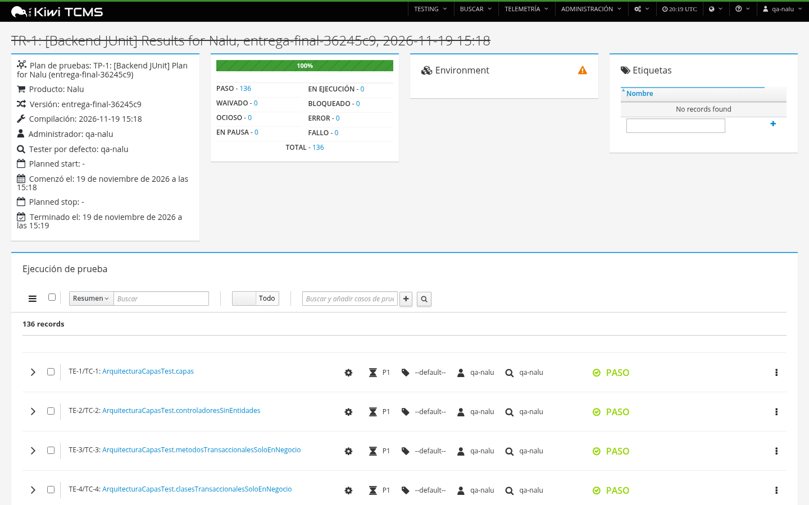
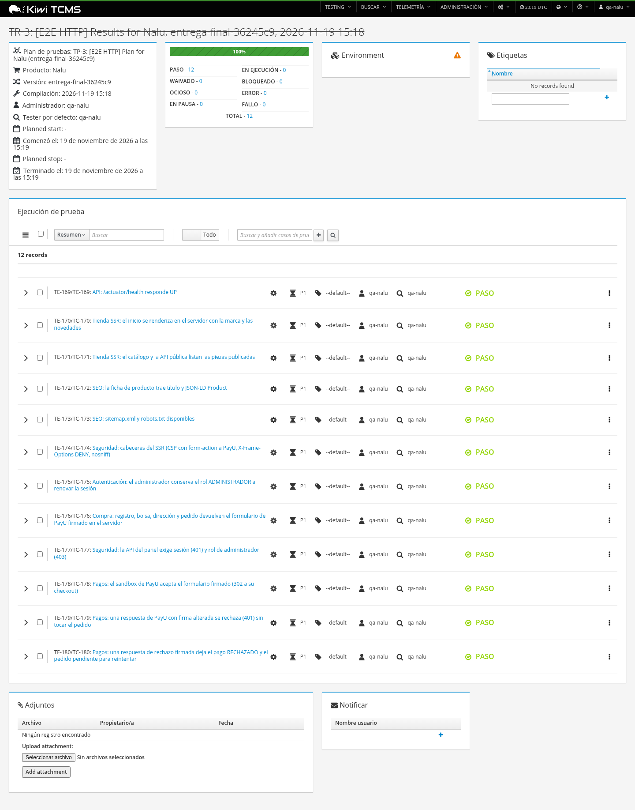
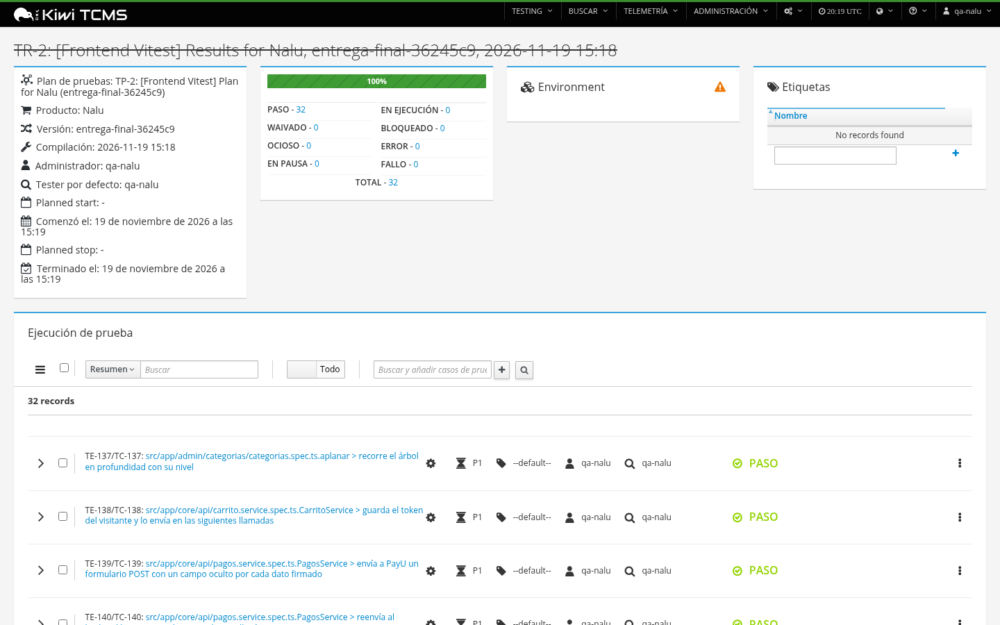

# Informe de pruebas en Kiwi TCMS

- **Fecha:** 2026-11-19 15:19 (hora local)
- **Producto / versión / build en Kiwi:** Nalu / `entrega-final-36245c9` / `2026-11-19 15:18`
- **Commit probado:** `36245c9`
- **Gestor de pruebas:** Kiwi TCMS 17.1 local (`infraestructura/kiwi/docker-compose.yml`)
- **Cómo se generó:** `scripts/kiwi/publicar.sh` (resultados JUnit con `kiwitcms-junit.xml-plugin`, E2E y este informe con `tcms-api`)

## Resumen

**180 de 180 ejecuciones aprobadas** (100.0 %).

| Corrida | TestRun en Kiwi | Ejecuciones | Aprobadas | Fallidas | Otras |
|---|---|---|---|---|---|
| Backend: JUnit 5, Spring Boot y Testcontainers | TR-1 | 136 | 136 | 0 | 0 |
| Frontend: Vitest | TR-2 | 32 | 32 | 0 | 0 |
| E2E HTTP contra el proyecto en marcha | TR-3 | 12 | 12 | 0 | 0 |

Las ejecuciones con otro estado (`ERROR`, `BLOCKED`, `WAIVED`) aparecerían en «Otras».

## Fallos

Ninguno.

## Pruebas E2E contra el proyecto en marcha

Por HTTP contra la tienda (`:4200`, SSR) y la API (`:8080`) en ejecución, más el sandbox real de PayU.

| Caso | Resultado | Detalle | Tiempo |
|---|---|---|---|
| API: /actuator/health responde UP | ✅ Aprobada | 200 UP | 0.1 s |
| Tienda SSR: el inicio se renderiza en el servidor con la marca y las novedades | ✅ Aprobada | 200, 59660 bytes de HTML | 0.1 s |
| Tienda SSR: el catálogo y la API pública listan las piezas publicadas | ✅ Aprobada | 21 piezas publicadas | 0.0 s |
| SEO: la ficha de producto trae título y JSON-LD Product | ✅ Aprobada | /producto/dije-halo-de-esmeralda: «Dije Halo de Esmeralda · Nalu» | 0.0 s |
| SEO: sitemap.xml y robots.txt disponibles | ✅ Aprobada | 27 URL en el sitemap | 0.0 s |
| Seguridad: cabeceras del SSR (CSP con form-action a PayU, X-Frame-Options DENY, nosniff) | ✅ Aprobada | CSP, X-Frame-Options y nosniff presentes | 0.0 s |
| Autenticación: el administrador conserva el rol ADMINISTRADOR al renovar la sesión | ✅ Aprobada | refresh → ADMINISTRADOR; el token renovado abre /admin | 0.3 s |
| Compra: registro, bolsa, dirección y pedido devuelven el formulario de PayU firmado en el servidor | ✅ Aprobada | pedido NALU-RBH67F, total 980000 COP, firma MD5 correcta | 0.3 s |
| Seguridad: la API del panel exige sesión (401) y rol de administrador (403) | ✅ Aprobada | sin token → 401; con token de cliente → 403 | 0.0 s |
| Pagos: el sandbox de PayU acepta el formulario firmado (302 a su checkout) | ✅ Aprobada | 302 → https://sandbox.checkout.payulatam.com/ppp-web-gateway-payu/app/v4 | 0.7 s |
| Pagos: una respuesta de PayU con firma alterada se rechaza (401) sin tocar el pedido | ✅ Aprobada | 401 | 0.0 s |
| Pagos: una respuesta de rechazo firmada deja el pago RECHAZADO y el pedido pendiente para reintentar | ✅ Aprobada | NALU-RBH67F: pedido PENDIENTE_PAGO, pago RECHAZADO | 0.0 s |

## Pruebas automatizadas por componente

### Backend: JUnit 5, Spring Boot y Testcontainers (TR-1)

| Clase o archivo de pruebas | Casos |
|---|---|
| `ArquitecturaCapasTest` | 9 |
| `co.nalu.NaluApplicationTests` | 1 |
| `co.nalu.api.admin.CatalogoAdminTest` | 7 |
| `co.nalu.api.admin.OperacionTest` | 5 |
| `co.nalu.api.cliente.CompraTest` | 10 |
| `co.nalu.api.cliente.CuentaClienteTest` | 5 |
| `co.nalu.api.cliente.PagoPayuTest` | 6 |
| `co.nalu.api.error.ManejadorErroresTest` | 9 |
| `co.nalu.api.publico.AsistenteApiTest` | 7 |
| `co.nalu.api.publico.AutenticacionTest` | 16 |
| `co.nalu.api.publico.CatalogoPublicoTest` | 5 |
| `co.nalu.api.publico.RegistroYFuerzaBrutaTest` | 6 |
| `co.nalu.config.JwtPropertiesTest` | 3 |
| `co.nalu.datos.entidad.CategoriaTest` | 4 |
| `co.nalu.datos.entidad.MapeoCuentasTest` | 3 |
| `co.nalu.datos.entidad.ProductoTest` | 9 |
| `co.nalu.datos.entidad.RefreshTokenTest` | 5 |
| `co.nalu.datos.entidad.VarianteProductoTest` | 6 |
| `co.nalu.integracion.gemini.GeminiModeloConversacionalTest` | 8 |
| `co.nalu.integracion.payu.PayuPasarelaTest` | 9 |
| `co.nalu.negocio.comun.FormateadorMensajesValidacionTest` | 3 |

### Frontend: Vitest (TR-2)

| Clase o archivo de pruebas | Casos |
|---|---|
| `src/app/admin/categorias/categorias.spec.ts` | 1 |
| `src/app/core/api/carrito.service.spec.ts` | 1 |
| `src/app/core/api/pagos.service.spec.ts` | 2 |
| `src/app/core/api/problema.spec.ts` | 3 |
| `src/app/core/auth/auth.interceptor.spec.ts` | 6 |
| `src/app/core/auth/auth.service.spec.ts` | 8 |
| `src/app/core/auth/rol.guard.spec.ts` | 3 |
| `src/app/cuenta/destino-seguro.spec.ts` | 2 |
| `src/app/cuenta/registro/registro.spec.ts` | 3 |
| `src/app/shared/asistente/formato.spec.ts` | 3 |

## Capturas de Kiwi TCMS





## Cómo repetirlo

```bash
docker compose -f infraestructura/kiwi/docker-compose.yml up -d   # Kiwi en https://localhost:8443
scripts/kiwi/publicar.sh                                          # con Nalu en marcha
```

El detalle de cada ejecución (casos, estados, tiempos y comentarios) está en `resultados.json` y en la interfaz de Kiwi (Test Runs del producto Nalu).
